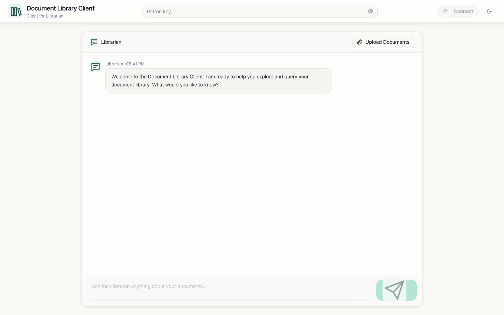

# Document Library Client (Patron)

Upload a manual to your Librarian server, wait for it to be indexed, and ask a question about it from your browser. Patron provides the reader interface. Librarian stores the documents, searches them, and calls the answer provider.



## Features

- Connect with a dedicated Patron key and choose among the answer providers configured on your server.
- Drop files into the upload panel and follow each document from upload through indexing.
- Ask questions across your library. API callers can also narrow retrieval to specific document IDs.
- Switch between light and dark mode. The browser remembers your theme and keeps the key and conversation in memory.

## Requirements

Use Node.js 22.12 or newer with npm, and Python 3.12 with pip. To upload or chat, you also need a Librarian instance with the Patron session and document-status endpoints, at least one configured answer provider, and a dedicated Patron key from its operator.

## Quick start

Download or clone the project and open a terminal in the directory containing `package.json`. On macOS or Linux, run:

```sh
cp .env.example .env
python3.12 -m venv backend/.venv
backend/.venv/bin/python -m pip install -r backend/requirements.txt
npm ci
npm run build
backend/.venv/bin/python -m uvicorn main:app --app-dir backend --host 127.0.0.1 --port 5055 --no-access-log
```

Open **http://127.0.0.1:5055**. The blank configuration uses Librarian on the same machine. For a remote library, set its HTTPS address in `.env` and restart Patron.

On Windows, use Python 3.12 to create `backend\.venv`, install the requirements with that environment's Python interpreter, and run the same npm install and build steps. Then double-click `launch_patron.bat` and open the address it prints.

## Configuration

| Setting | Where | Purpose | Example |
|---|---|---|---|
| `PATRON_LIBRARIAN_URL` | Root `.env` or process environment | Base address of the Librarian instance. A blank value uses `http://127.0.0.1:8000`. A process environment setting takes precedence. | `https://library.example.org` |

On the **Librarian server**, set `LIBRARIAN_PATRON_API_KEY` to a generated secret distinct from its administrator key, `LIBRARIAN_APP_API_KEY`. Restart Librarian after setting the key. Configure an answer provider with a base URL, default model, and any credential that provider requires. Give readers the dedicated Patron key.

## Add documents and ask a question

1. Enter your Patron key and select **Connect**. If no providers appear and the connection reports a configuration error, ask the Librarian operator to check the provider settings.
2. Select **Upload Documents**, choose a file, and submit it. Patron accepts up to 16 MiB per file. The API accepts up to eight files in a request and 32 MiB total, including multipart overhead.
3. Wait for **Indexed**, choose an answer provider, and ask about a fact in the document. **Processing** means Librarian is still indexing it.
4. Select the connection button to disconnect and clear the key. A browser refresh clears the conversation.

## Build and deploy

`npm run build` type-checks the frontend and writes its production assets to `dist/`. Launch the backend after building so FastAPI serves both the interface and the API on port 5055. For frontend development, leave that backend running and start `npm run dev` in a second terminal. Open the local address Vite prints, normally **http://127.0.0.1:8080**.

For shared hosting, put HTTPS in front of Patron and keep Uvicorn on loopback. This Caddyfile example forwards both the UI and API. Replace the example domain with your own and point its DNS at the proxy.

```caddyfile
patron.example.org {
    reverse_proxy 127.0.0.1:5055
}
```

## Security

Keep actual credentials out of source control. The root `.env` is ignored. Patron sends the key in the `X-API-Key` header, restricts remote upstreams to HTTPS, and declines upstream redirects. Configure ingress logs to omit credentials and request bodies, and enforce upload-size and rate limits at the public entry points. A Patron key grants shared library access, so distribute it only to people who should be able to query that library.

## Project structure

```text
src/components/           Connection controls, upload panel and chat
src/hooks/                Connection state and theme preferences
backend/main.py           API routes, upload limits and static file serving
backend/librarian_client.py  Upstream connection and error handling
backend/tests/            Proxy tests and the disposable-library smoke check
src/test/                 Frontend regression tests
.env.example              Upstream configuration example
launch_patron.bat         Windows launcher for the built client
```

## Contributing

Issues and pull requests are welcome. For a bug report, include the steps to reproduce it and any error message with credentials removed. Contributions are accepted under the project license.

## License

Copyright © 2026 BotwinDOTTokyo LLC and Prof. M. Botwin.

The PolyForm Noncommercial License 1.0.0 permits use, modification, and sharing for noncommercial purposes under its terms. Selling the software or using it commercially requires separate permission from the owners. Open a repository issue to ask about commercial licensing. [Read the full license](LICENSE).
